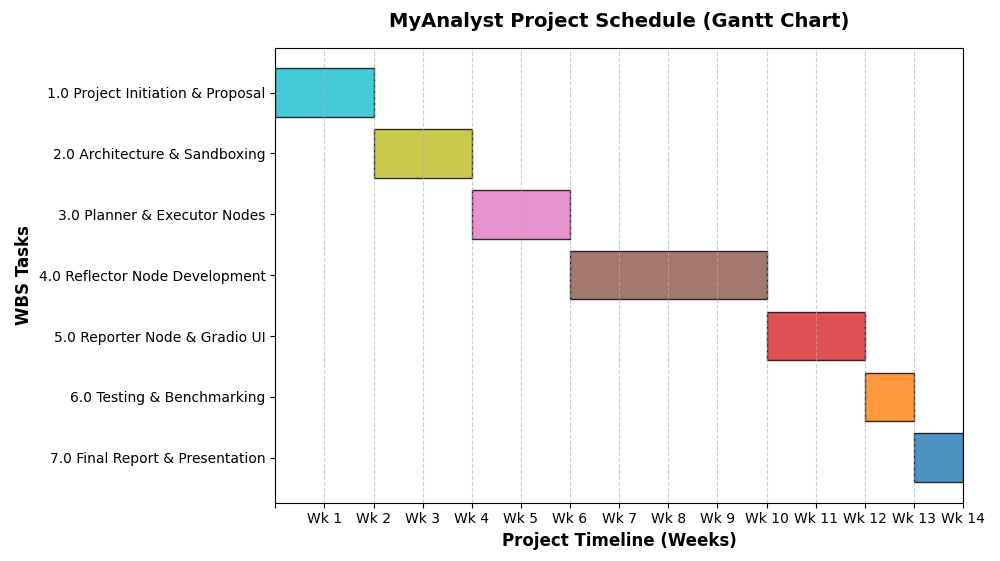

# Project Scope and Gantt Chart Development

## Project Scope and Boundaries

MyAnalyst is a research-oriented project aimed at developing an autonomous Large Language Model (LLM) agent capable of executing end-to-end data science workflows without human intervention. The project focuses on creating a planner-executor-reflector architecture that processes structured tabular data, executes machine learning pipelines, autonomously corrects errors, and generates business intelligence reports.

The defined scope strictly limits MyAnalyst to tabular data and classic machine learning algorithms, preventing the schedule overruns typically associated with deep learning or unstructured data processing.

## Project Scope Statement

The project scope statement establishes the defined boundaries, acceptance criteria, and specific deliverables required for project success (Schwalbe, 2019).

**Product Scope Description**
Development of MyAnalyst, a proof-of-concept autonomous LLM agent utilizing a LangGraph state-machine architecture. The system will process raw tabular data, execute standard machine learning pipelines in a sandboxed environment, autonomously correct intermediate code/logic errors, and output a natural-language business intelligence report.

**Acceptance Criteria**

* The agent must successfully complete an end-to-end analysis on two distinct public datasets (e.g., Telco Customer Churn, California Housing Prices) without human intervention.
* The self-reflection module must demonstrate the ability to catch and correct at least one syntax error and one logical data science error (e.g., target leakage) during execution.
* The final output must be a readable business report accompanied by functional Python scripts.

**Deliverables**

* **Project Documentation:** Approved research proposal, literature review, and final academic report.
* **Software:** A functional LangGraph-based state machine, a secure local Python REPL environment, and a Gradio web interface.
* **Evaluation Results:** Benchmarking metrics comparing the agent's performance against a static baseline model.

**Project Boundaries (In-Scope vs. Out-of-Scope)**

| Category | In-Scope | Out-of-Scope |
| --- | --- | --- |
| **Data Types** | Structured tabular data (CSV/Excel) | Images, audio, or unstructured text |
| **Algorithms** | 3–5 classic scikit-learn models (e.g., Random Forest) | Deep learning, neural networks, LLM fine-tuning |
| **Architecture** | Single sequential state machine agent | Multi-agent hierarchical collaboration |
| **Environment** | Local execution sandboxed via REPL | Live production APIs or real-time streaming |

**Constraints and Assumptions**

* **Constraints:** The project is strictly bound to a 14-week academic timeline. Compute resources are limited to standard local hardware and basic cloud LLM API access, necessitating strict prompt optimization to manage context window limits.
* **Assumptions:** Public benchmark datasets remain accessible. The underlying LLM maintains consistent zero-shot Python coding capabilities.

---

## Requirements Traceability Matrix (RTM)

The RTM maps high-level project requirements to their corresponding deliverables, ensuring no stakeholder need is overlooked during implementation.

| Requirement ID | Description | Linked Deliverable |
| --- | --- | --- |
| REQ-01 | Autonomous workflow planning | LangGraph Planner Node |
| REQ-02 | Safe code execution | Sandboxed Python REPL |
| REQ-03 | Autonomous error correction | Reflector Node logic |
| REQ-04 | User accessibility | Gradio Web Interface |
| REQ-05 | Interpretable results | Natural-Language Business Report |

---

## Work Breakdown Structure (WBS)

Utilizing a top-down approach, the overarching project is decomposed into manageable work packages to facilitate precise scheduling and resource allocation.

* **1.0 Project Initiation & Planning**
    * 1.1 Finalize topic and objectives
    * 1.2 Conduct literature review
    * 1.3 Draft and submit research proposal

* **2.0 System Architecture & Environment**
    * 2.1 Design LangGraph state machine
    * 2.2 Configure isolated Python REPL sandbox
    * 2.3 Procure and format benchmark datasets

* **3.0 Agent Development: Phase 1**
    * 3.1 Develop Planner node prompts
    * 3.2 Develop Executor node for `pandas` and `scikit-learn`

* **4.0 Agent Development: Phase 2**
    * 4.1 Develop Reflector node for syntax error recovery
    * 4.2 Expand Reflector logic for data science validation

* **5.0 Integration & User Interface**
    * 5.1 Develop Reporter node for insight generation
    * 5.2 Build and connect Gradio interface

* **6.0 Testing & Benchmarking**
    * 6.1 Execute baseline static models
    * 6.2 Run MyAnalyst end-to-end on target datasets
    * 6.3 Apply evaluation rubric to outputs

* **7.0 Project Closure**
    * 7.1 Compile findings and empirical data
    * 7.2 Draft final academic report
    * 7.3 Prepare live demonstration and presentation

---

## Key Tasks, Milestones, and Gantt Chart

The project is decomposed into sequential tasks engineered to mitigate architectural risk early in the development lifecycle.

* **Milestone 1:** System Architecture Finalized (Week 4).
* **Milestone 2:** Functional Autonomous Execution and Reflection Loop (Week 10).
* **Milestone 3:** End-to-End System Integration Complete (Week 12).
* **Milestone 4:** Final Academic Report and Demonstration (Week 14).

**Project Schedule**
The following schedule tracks the sequential and parallel relationships of the WBS activities across the 14-week execution window.

| WBS Task | Description                   | Duration | Start Week | End Week |
| -------- | ----------------------------- | -------- | ---------- | -------- |
| **1.0**  | Project Initiation & Proposal | 2 Weeks  | Week 1     | Week 2   |
| **2.0**  | Architecture & Sandboxing     | 2 Weeks  | Week 3     | Week 4   |
| **3.0**  | Planner & Executor Nodes      | 2 Weeks  | Week 5     | Week 6   |
| **4.0**  | Reflector Node Development    | 4 Weeks  | Week 7     | Week 10  |
| **5.0**  | Reporter Node & Gradio UI     | 2 Weeks  | Week 11    | Week 12  |
| **6.0**  | Testing & Benchmarking        | 1 Week   | Week 13    | Week 13  |
| **7.0**  | Final Report & Presentation   | 1 Week   | Week 14    | Week 14  |
|          |                               |          |            |          |
|          |                               |          |            |          |

---

## Scope and Timeline Justification

The 14-week timeline supports successful project execution by front-loading architectural design and allocating a significant portion of the schedule (4 Weeks) exclusively to the core implementation of the Reflector logic (Phase 2). Because autonomous self-correction is the most technically complex and uncertain component of the research, isolating it within this extended block ensures the underlying agent functions correctly before resources are diverted to user interface development or empirical benchmarking.

## Project Plan Outline

* **Guidelines:** Development will strictly adhere to PEP 8 Python coding standards. All LLM-generated code must execute within a local, restricted environment to prevent arbitrary code execution vulnerabilities. Research will utilize only public, anonymized datasets to maintain ethical compliance.
* **Resources Required:** * *Hardware:* Local workstation capable of running Python 3.10+ (minimum 16GB RAM).
* *Software/Libraries:* LangGraph, scikit-learn, pandas, Gradio.
* *Cloud:* Paid API access to an LLM provider (e.g., OpenAI or Anthropic) with a projected testing budget.
* *Data:* Access to Kaggle or UCI Machine Learning Repository for benchmark datasets.

---

**References**

* Project Management Institute. (2021). *A guide to the project management body of knowledge (PMBOK guide)* (7th ed.). Project Management Institute.
* Schwalbe, K. (2019). *Information technology project management* (9th ed.). Cengage Learning.